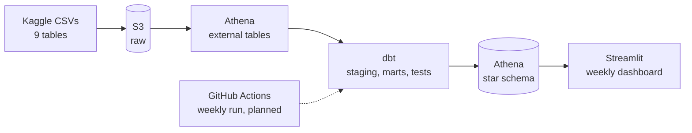

# olist-delivery-seller-health

ELT pipeline and weekly dashboard on the Olist marketplace dataset (S3, Athena, dbt, Streamlit).

> **Status:** work in progress. Sections marked `TBD` are filled in as the project advances.

## Why this project

Marketplaces depend on delivery reliability: a late package hurts the customer's review, the seller's reputation and the platform's trust. This project models the public Olist order data into an analytics-ready warehouse and tracks four delivery and seller-health metrics on a weekly basis.

## Business questions

1. How accurate are the delivery promises (estimated vs. actual delivery date)?
2. How much do late deliveries lower customer review scores?
3. Is late shipping concentrated in a small group of sellers?
4. Which regions need a recalibrated delivery promise, and how many days could be removed without hurting on-time delivery?

## Dataset

[Brazilian E-Commerce Public Dataset by Olist](https://www.kaggle.com/datasets/olistbr/brazilian-ecommerce) on Kaggle: about 100K orders across 9 CSV tables (orders, order items, payments, reviews, customers, sellers, products, geolocation, category name translation).

The raw files are **not** committed to this repository. Download them from Kaggle and check the dataset license there before reusing or redistributing the data.

## Architecture



| Layer | Tool | Role |
|---|---|---|
| Storage | Amazon S3 | Landing zone for the raw CSV files |
| Query engine | Amazon Athena | Serverless SQL directly on S3 |
| Transformation | dbt | Versioned SQL models, tests and documentation |
| Serving | Streamlit | Weekly business review dashboard |
| Orchestration | GitHub Actions (planned) | Scheduled weekly run |

## Data model (planned)

| Table | Type | Grain |
|---|---|---|
| `fact_orders` | fact | one row per order |
| `fact_order_items` | fact | one row per item in an order |
| `dim_customers` | dimension | one row per customer |
| `dim_sellers` | dimension | one row per seller |
| `dim_products` | dimension | one row per product |
| `dim_date` | dimension | one row per calendar day |

## Metrics (draft)

<!-- TODO: verify column names against the downloaded files and finalize the definitions with the data. -->

| Metric | Definition |
|---|---|
| On-time delivery rate | Delivered orders with `order_delivered_customer_date` <= `order_estimated_delivery_date`, divided by all delivered orders |
| Delivery-promise accuracy | Gap in days between the estimated and the actual delivery date (positive = earlier than promised) |
| Seller late-shipment rate | Share of a seller's items handed to the carrier after `shipping_limit_date` |
| Low-rating rate | Share of reviews with `review_score` <= 2 |

The weekly dashboard shows each metric with week-over-week change and an anomaly flag (rule to be defined, e.g. outside the recent weekly range).

## Data quality

Goal: 40+ automated dbt tests across staging and marts, covering:

- keys: not null, unique
- relationships between tables
- accepted values (for example order status)
- business rules (for example a delivery date cannot be earlier than the purchase date)
- duplicates (for example repeated reviews)

Issues found: `TBD`

## Repository structure

```
olist-delivery-seller-health/
├── README.md
├── docs/            architecture diagram, data dictionary, decision notes
├── data/            raw CSV files, local only (gitignored)
├── notebooks/       exploratory analysis
├── ingestion/       scripts that upload the raw files to S3
├── dbt/             models (staging, marts), tests, docs
├── app/             Streamlit dashboard
└── slides/          project presentation
```

## Getting started

`TBD`: commands are added as each step is built.

1. Download the dataset from Kaggle into `data/`.
2. Configure AWS credentials locally. Never commit credentials.
3. Upload the raw files to S3 (`ingestion/`).
4. Run and test the dbt models.
5. Start the Streamlit app.

## Roadmap

- [ ] Repository, README and AWS account with a billing alarm
- [ ] Local exploratory analysis of all 9 tables (grain, relationships, data quality notes)
- [ ] Upload raw data to S3 and create Athena tables
- [ ] dbt staging models and first tests
- [ ] Star schema and 40+ tests
- [ ] Metrics and weekly Streamlit dashboard
- [ ] Analysis: late delivery vs. review score, seller concentration, regional promise calibration
- [ ] Scheduled weekly run
- [ ] Architecture diagram, final README and slides

## Findings

`TBD`: results are added here once the analysis is complete.

| Question | Result |
|---|---|
| Review score on late vs. on-time deliveries | TBD |
| Share of sellers behind the late shipments | TBD |
| Suggested promise change by region | TBD |

## Limitations

- The dataset is a historical snapshot. A weekly schedule demonstrates orchestration and incremental processing, not fresh data.
- Region-level conclusions depend on how many orders each region has.

## Author

`Simanur Hattapoğlu` · [LinkedIn](https://www.linkedin.com/simanur-hattapoglu/) · [GitHub](https://github.com/faranji)

